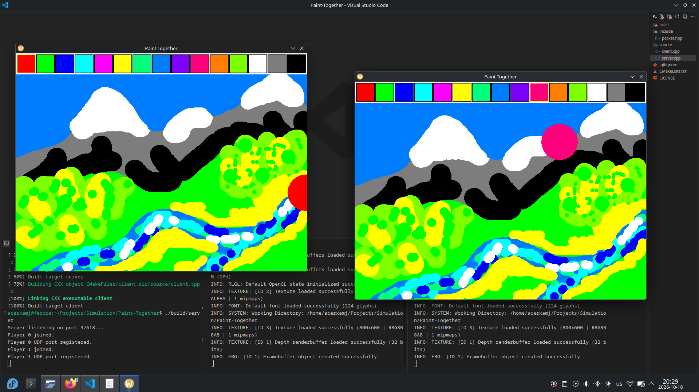
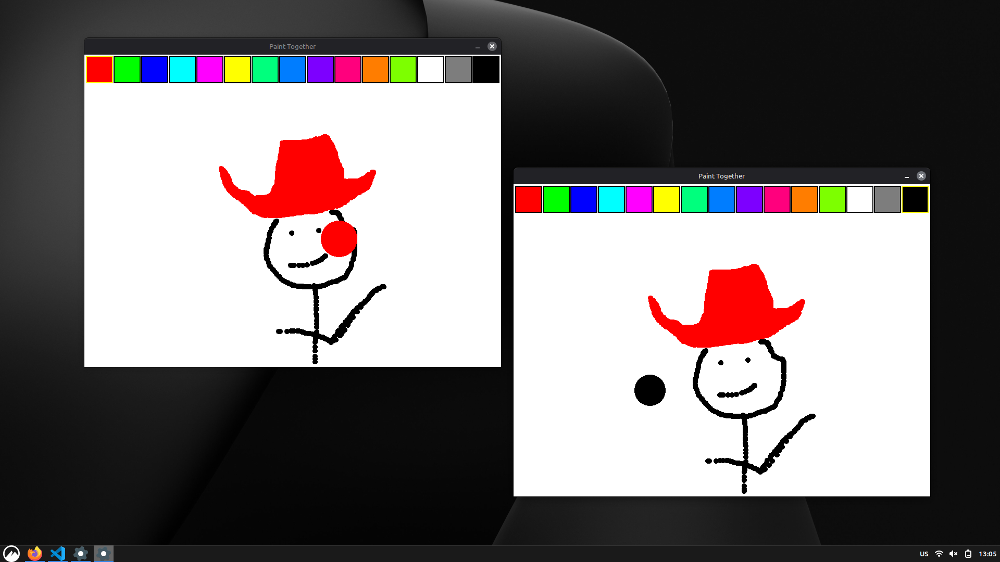

# Paint Together
Paint together is a drawing application where you can draw with your friends. This repository contains both the server and the client applications. Due to limitations you can only connect to server if it's on the same machine. This is more of a learning project than an actual product.





## Building
This project depends on C++17, [Raylib](https://www.raylib.com/) for rendering and [SFML](https://www.sfml-dev.org/) for networking. The recommended way to build the project is using CMake. It will build both the server and client executables:
```bash
cmake -B build
cmake --build build
```
Server will be located in `build/server` and the client in `build/client`.

## Usage
First run the server:
```
./build/server
Server listening on port 37618...
```
Server will tell you on which port it is listening. Open up as many clients as you'd like to and input the port when asked:
```
./build/client
Input server's port: 37618
Connected to the server!
```

## Credits
This project was made by Daniel Vishnevsky and is licensed under MIT License.
